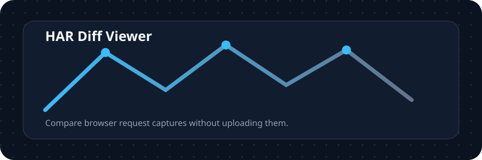

<div align="center">


[](LICENSE)



</div>

## :compass: Overview

A privacy-first React tool for comparing two HAR files. It matches requests by method and URL, then highlights added, removed, and changed responses without uploading capture data.

## :sparkles: Features

- :white_check_mark: Loads HAR JSON files locally in the browser
- :white_check_mark: Compares request status, response size, timing, and headers
- :white_check_mark: Filters added, removed, changed, and unchanged requests
- :white_check_mark: Keeps HAR contents in the current browser tab only

## :clapper: Demo

```bash
npm start
```

The example runs locally; no hosted service or upload is required.

## :rocket: Quick Start

```bash
npm install
npm start
```

## :toolbox: Tech Stack

- React, TypeScript, Vite, and Vitest
- Automated tests: Vitest unit tests for HAR matching and change detection
- Local-first processing

## :file_folder: Folder Structure

```text
har-diff-viewer/
├── index.html
├── package.json
├── vite.config.ts
├── src/App.tsx
├── src/diff.ts
├── src/diff.test.ts
├── src/style.css
└── assets/illustration.svg
```

## :world_map: Roadmap

- [x] Core workflow
- [x] Example input and tests
- [ ] Additional report formats
- [ ] Continuous integration on supported platforms

## :handshake: Contributing

Issues and pull requests are welcome. Keep changes focused, document behavior changes, and add tests for new features.

## :page_facing_up: License

MIT - see [LICENSE](LICENSE).

<div align="center"></div>
